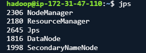
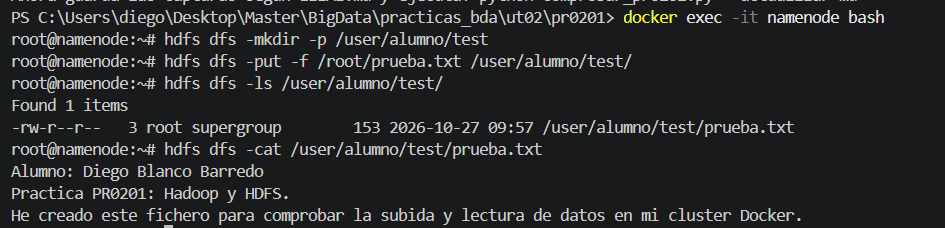
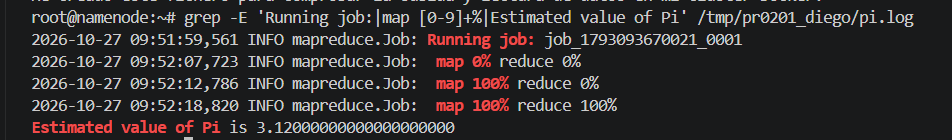

---
---
# PR0201. Instalación y comprobación de Hadoop

**Alumno: Diego Blanco Barredo**

Hice la primera comprobación en AWS y el resto de las pruebas en Docker, como me indicó el profesor.

## 1. Servicios en AWS

Me conecté a la máquina de AWS con el usuario `hadoop` y ejecuté `jps` para ver los procesos de Hadoop.

En la captura aparecen DataNode, SecondaryNameNode, ResourceManager y NodeManager. NameNode no salía, pero el profesor aceptó esta captura y me indicó continuar en Docker.



## 2. Subida y lectura de un fichero en HDFS

Para esta parte utilicé el clúster de Docker de clase, con Hadoop 3.4.0. Entré en el contenedor `namenode`, creé la carpeta `/user/alumno/test` y subí `prueba.txt` con un texto que incluye mi nombre.

Después listé la carpeta y leí el fichero desde HDFS. El contenido era el mismo que había escrito, así que la subida y la lectura funcionaron.



## 3. Interfaz web del NameNode

Abrí la web del NameNode en [http://localhost:9870/dfshealth.html](http://localhost:9870/dfshealth.html).

En la captura se ven **4 nodos activos y 0 nodos muertos**, que corresponden al clúster de Docker.


## 4. Prueba de MapReduce

Ejecuté el ejemplo que calcula una aproximación de pi, con dos tareas map y 100 muestras por tarea.

El trabajo se ejecutó en YARN y terminó correctamente. Los maps y reduces llegaron al **100 %** y el resultado fue **3,12**.



### Comando utilizado

```bash
hadoop jar /usr/local/hadoop/share/hadoop/mapreduce/hadoop-mapreduce-examples-3.4.0.jar pi \
  -Dmapreduce.framework.name=yarn \
  -Dmapreduce.map.memory.mb=512 \
  -Dmapreduce.map.java.opts=-Xmx384m \
  -Dmapreduce.reduce.memory.mb=512 \
  -Dmapreduce.reduce.java.opts=-Xmx384m \
  -Dyarn.app.mapreduce.am.resource.mb=512 \
  -Dyarn.app.mapreduce.am.command-opts=-Xmx384m \
  2 100
```

### Salida completa de la ejecución

```text
Number of Maps  = 2
Samples per Map = 100
Wrote input for Map #0
Wrote input for Map #1
Starting Job
2026-10-27 09:51:57,252 INFO client.DefaultNoHARMFailoverProxyProvider: Connecting to ResourceManager at yarnmanager/172.18.0.7:8032
2026-10-27 09:51:57,710 INFO mapreduce.JobResourceUploader: Disabling Erasure Coding for path: /tmp/hadoop-yarn/staging/root/.staging/job_1793093670021_0001
2026-10-27 09:51:57,932 INFO input.FileInputFormat: Total input files to process : 2
2026-10-27 09:51:58,076 INFO mapreduce.JobSubmitter: number of splits:2
2026-10-27 09:51:58,512 INFO mapreduce.JobSubmitter: Submitting tokens for job: job_1793093670021_0001
2026-10-27 09:51:58,512 INFO mapreduce.JobSubmitter: Executing with tokens: []
2026-10-27 09:51:58,894 INFO conf.Configuration: resource-types.xml not found
2026-10-27 09:51:58,895 INFO resource.ResourceUtils: Unable to find 'resource-types.xml'.
2026-10-27 09:51:59,532 INFO impl.YarnClientImpl: Submitted application application_1793093670021_0001
2026-10-27 09:51:59,560 INFO mapreduce.Job: The url to track the job: http://yarnmanager:8088/proxy/application_1793093670021_0001/
2026-10-27 09:51:59,561 INFO mapreduce.Job: Running job: job_1793093670021_0001
2026-10-27 09:52:07,722 INFO mapreduce.Job: Job job_1793093670021_0001 running in uber mode : false
2026-10-27 09:52:07,723 INFO mapreduce.Job:  map 0% reduce 0%
2026-10-27 09:52:12,786 INFO mapreduce.Job:  map 100% reduce 0%
2026-10-27 09:52:18,820 INFO mapreduce.Job:  map 100% reduce 100%
2026-10-27 09:52:18,828 INFO mapreduce.Job: Job job_1793093670021_0001 completed successfully
2026-10-27 09:52:18,900 INFO mapreduce.Job: Counters: 54
        File System Counters
                FILE: Number of bytes read=50
                FILE: Number of bytes written=933849
                FILE: Number of read operations=0
                FILE: Number of large read operations=0
                FILE: Number of write operations=0
                HDFS: Number of bytes read=524
                HDFS: Number of bytes written=215
                HDFS: Number of read operations=13
                HDFS: Number of large read operations=0
                HDFS: Number of write operations=3
                HDFS: Number of bytes read erasure-coded=0
        Job Counters
                Launched map tasks=2
                Launched reduce tasks=1
                Data-local map tasks=2
                Total time spent by all maps in occupied slots (ms)=4203
                Total time spent by all reduces in occupied slots (ms)=3192
                Total time spent by all map tasks (ms)=4203
                Total time spent by all reduce tasks (ms)=3192
                Total vcore-milliseconds taken by all map tasks=4203
                Total vcore-milliseconds taken by all reduce tasks=3192
                Total megabyte-milliseconds taken by all map tasks=4303872
                Total megabyte-milliseconds taken by all reduce tasks=3268608
        Map-Reduce Framework
                Map input records=2
                Map output records=4
                Map output bytes=36
                Map output materialized bytes=56
                Input split bytes=288
                Combine input records=0
                Combine output records=0
                Reduce input groups=2
                Reduce shuffle bytes=56
                Reduce input records=4
                Reduce output records=0
                Spilled Records=8
                Shuffled Maps =2
                Failed Shuffles=0
                Merged Map outputs=2
                GC time elapsed (ms)=112
                CPU time spent (ms)=1360
                Physical memory (bytes) snapshot=947646464
                Virtual memory (bytes) snapshot=6283210752
                Total committed heap usage (bytes)=762314752
                Peak Map Physical memory (bytes)=350736384
                Peak Map Virtual memory (bytes)=2092220416
                Peak Reduce Physical memory (bytes)=246890496
                Peak Reduce Virtual memory (bytes)=2099240960
        Shuffle Errors
                BAD_ID=0
                CONNECTION=0
                IO_ERROR=0
                WRONG_LENGTH=0
                WRONG_MAP=0
                WRONG_REDUCE=0
        File Input Format Counters
                Bytes Read=236
        File Output Format Counters
                Bytes Written=97
Job Finished in 21.719 seconds
Estimated value of Pi is 3.12000000000000000000
```

[Volver al índice de la UT02](../index.md)
